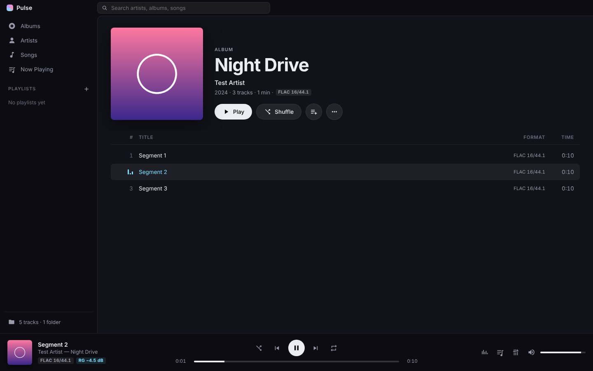
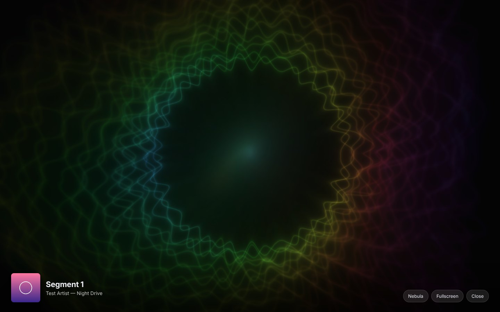
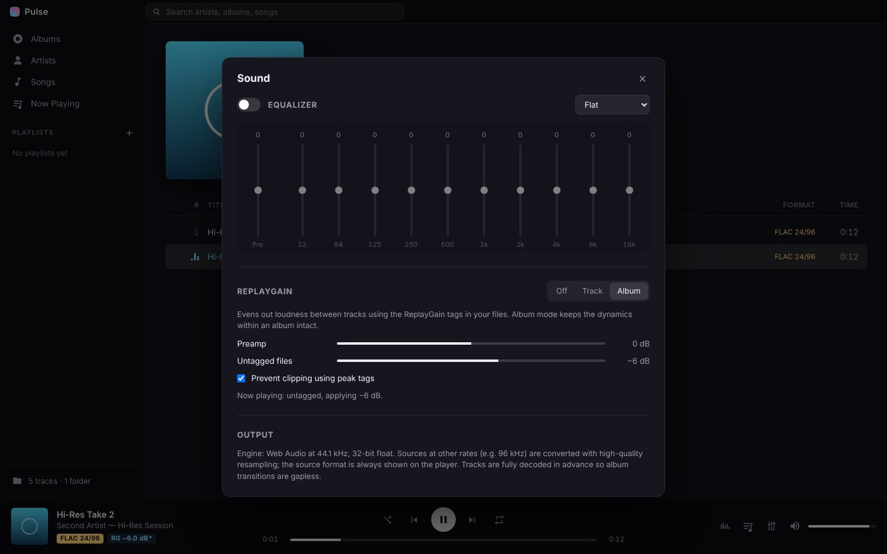
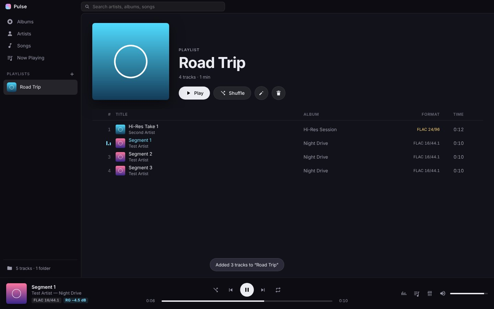

<p align="center"></p>

<h1 align="center">Pulse</h1>
<p align="center">A gapless FLAC music player for Windows and macOS, with a reactive visualizer.</p>

<p align="center"></p>

## Features

- **Music library**: point it at your music folders and browse by album, artist or song, with search. It reads tags and embedded cover art, or a `cover.jpg` / `folder.jpg` next to the files. Files are never modified.
- **Gapless playback**: tracks are decoded ahead of time and the next one is scheduled to start on the exact sample the current one ends.
- **Format readout**: shows the source format (e.g. `FLAC 24/96`), with hi-res albums marked in gold.
- **ReplayGain**: Track, Album or Off, with a preamp, a fallback gain for untagged files and clipping prevention from peak tags.
- **10-band equalizer** with presets and a preamp.
- **Playlists and queue**: drag to reorder, drag albums onto playlists, Play next, shuffle, repeat all / one. The session is restored on relaunch.
- **Visualizer**: four WebGL visuals that react to the music (Nebula, Spectrum Ring, Tunnel, Classic Bars), full screen.
- Media keys, the OS now-playing overlay, and opening `.flac` files from Explorer or Finder.

Supported formats: FLAC, MP3, AAC/M4A, WAV, OGG, Opus.

| Visualizer | Sound settings | Playlist |
|---|---|---|
|  |  |  |

## Download

Get the latest installers from the [Releases](../../releases) page:

- **Windows:** `Pulse-Setup-x.y.z.exe` (installer) or `Pulse-Portable-x.y.z.exe` (no install needed)
- **macOS:** `Pulse-x.y.z-universal.dmg` (runs on both Apple Silicon and Intel)

The builds are not code-signed:

- **Windows:** if SmartScreen says *"Windows protected your PC"*, click **More info → Run anyway**.
- **macOS:** on first launch, **right-click the app → Open**. If macOS says the app is damaged, run `xattr -cr /Applications/Pulse.app` in Terminal.

## Build from source

You need [Node.js](https://nodejs.org) 20 or newer.

```bash
npm install
npm start            # run the app
npm run dist:win     # Windows installer + portable exe  → dist/
npm run dist:mac     # macOS universal .dmg             → dist/   (must be run on a Mac)
```

### Automated builds

The included GitHub Actions workflow (`.github/workflows/build.yml`) builds Windows and macOS on every push. Download the results from the **Actions** tab → the run → **Artifacts**.

To publish a release, tag a version and push it:

```bash
git tag v1.0.0
git push origin v1.0.0
```

The workflow creates a GitHub Release with the installers attached.

## Keyboard shortcuts

| Key | Action |
|---|---|
| Space | Play / pause |
| Ctrl/⌘ + → / ← | Next / previous track |
| → / ← | Seek ±10 s |
| Ctrl/⌘ + ↑ / ↓ | Volume |
| S / R | Shuffle / repeat |
| V | Visualizer (N next visual, F full screen, Esc close) |
| Ctrl/⌘ + F | Search |
| Backspace | Back |

## How it works

| File | Role |
|---|---|
| `main.js` | Electron main process: window, library scanner ([music-metadata](https://github.com/borewit/music-metadata)), a `pulse://` protocol that serves the UI, cover art and audio with HTTP range support, and playlist storage |
| `preload.js` | Minimal context-isolated bridge between the UI and the main process |
| `src/engine.js` | Web Audio engine: gapless scheduling, a streaming fallback for very long tracks, ReplayGain, 10-band EQ and an analyser |
| `src/app.js` | The interface: library views, a virtualized track list, queue, playlists, sound panel |
| `src/visualizer.js` | WebGL fragment-shader visualizer with frame feedback |

The signal path is: source → ReplayGain → EQ preamp → 10 biquad bands → analyser → volume → output.

Playback runs in 32-bit float at the system output rate. Sources at other rates are resampled, and the original format is always shown. This is not an exclusive-mode (WASAPI exclusive / CoreAudio hog mode) bit-perfect output.

Tracks whose decoded size would exceed about 700 MB (roughly an hour or more of hi-res audio) stream through an `<audio>` element instead. Transitions around those tracks are near-gapless rather than sample-exact.

User data lives in `%APPDATA%\Pulse` (Windows) or `~/Library/Application Support/Pulse` (macOS).

## License

[MIT](LICENSE)
